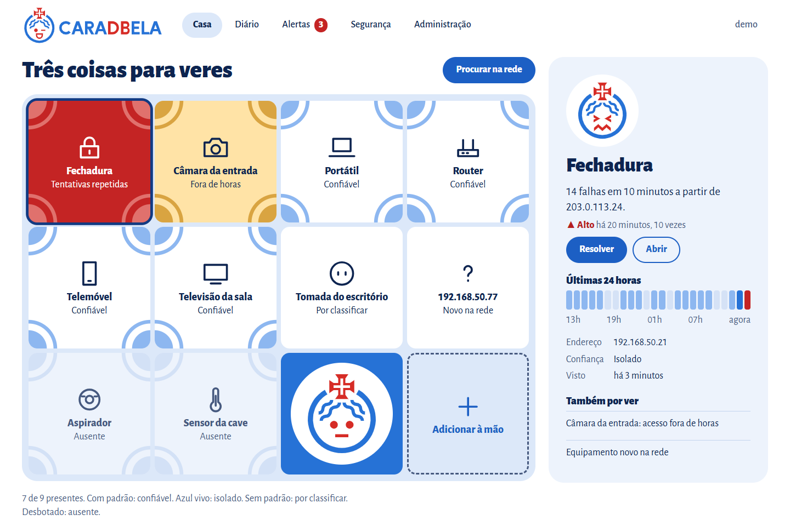
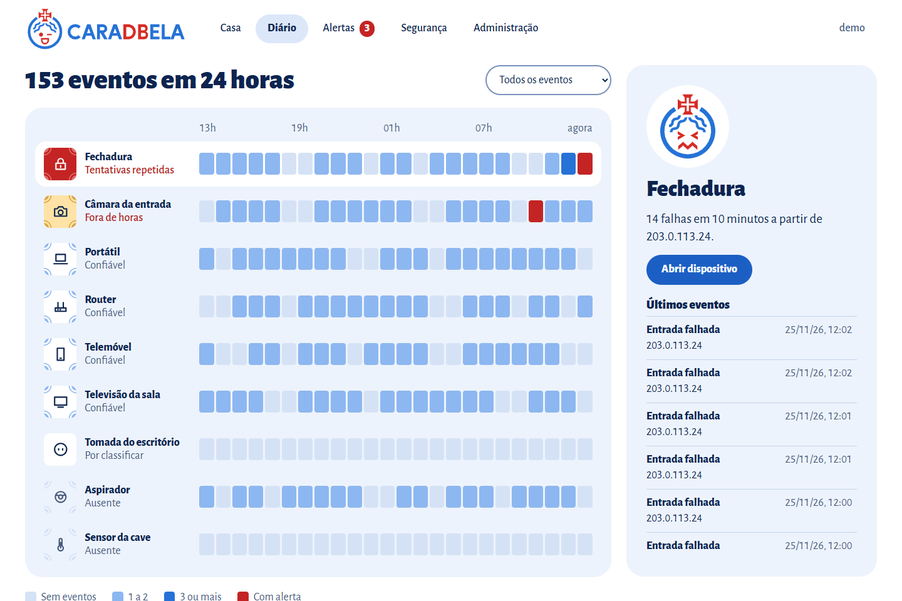
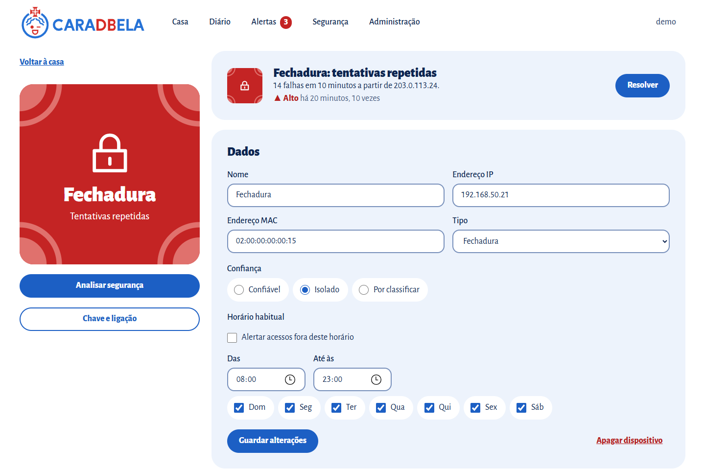
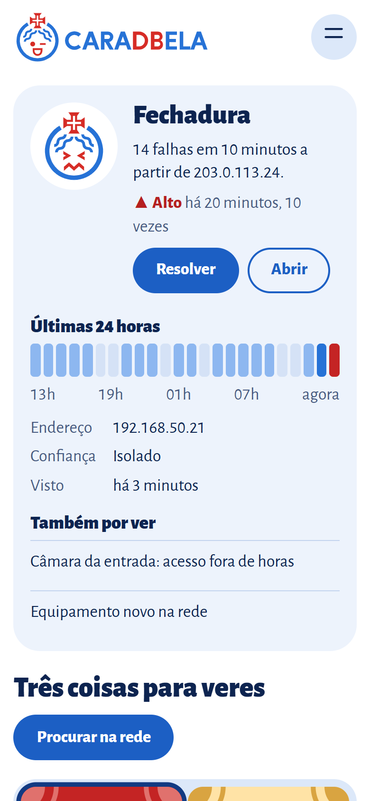
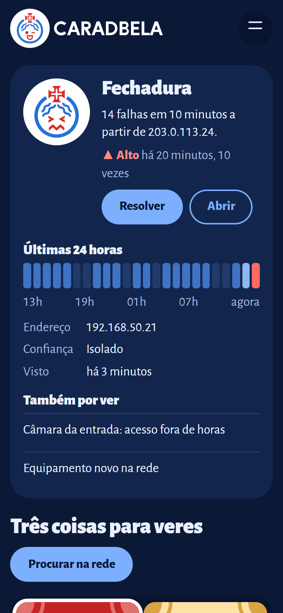

<div align="center">

<picture>
  <source media="(prefers-color-scheme: dark)" srcset="logo-kit/caradbela-horizontal-reversed.svg">
  
</picture>

### A tua IoT de forma bela.

Vigia os dispositivos inteligentes da tua rede, deteta acessos suspeitos e avisa-te.


[Experimentar](#experimentar-em-dois-minutos) &nbsp;|&nbsp; [Instalar](#instalar) &nbsp;|&nbsp; [O que deteta](#o-que-deteta) &nbsp;|&nbsp; [API](#enviar-eventos) &nbsp;|&nbsp; [Segurança](#segurança)

<br>



</div>

## O que é

Uma câmara acedida fora de horas. Uma fechadura com catorze tentativas falhadas vindas do mesmo endereço. Um equipamento que ninguém conhece ligado à rede. A CaraDBela regista estes acessos, reconhece os padrões suspeitos e explica-os em português claro.

Cada dispositivo é um azulejo numa parede. A cor e o padrão dizem em que estado está, e a cara da CaraDBela mostra como está a rede:

<table align="center">
  <tr>
    <td align="center" width="33%"></td>
    <td align="center" width="33%"></td>
    <td align="center" width="33%"></td>
  </tr>
  <tr>
    <td align="center"><b>Calma</b><br>Sem alertas</td>
    <td align="center"><b>Atenta</b><br>Entre um e quatro alertas</td>
    <td align="center"><b>Aflita</b><br>Cinco alertas ou mais</td>
  </tr>
</table>

- **Casa:** todos os dispositivos de relance, com os alertas primeiro.
- **Diário:** as últimas 24 horas de cada dispositivo, hora a hora.
- **Alertas em direto:** agrupados por causa, sem repetições.
- **Análise de segurança:** portas abertas e, com nmap, versões e vulnerabilidades conhecidas.
- **Várias contas:** cada pessoa vê apenas os seus dispositivos. Os administradores gerem as contas.
- **Sem serviços externos:** tipos de letra, imagens e código são servidos pelo teu computador.
- **Telemóvel e modo escuro** incluídos.

<table>
  <tr>
    <td width="50%"></td>
    <td width="50%"></td>
  </tr>
  <tr>
    <td align="center"><b>Diário</b></td>
    <td align="center"><b>Dispositivo</b></td>
  </tr>
</table>

<div align="center">
  
  &nbsp;&nbsp;
  
</div>

## Experimentar em dois minutos

Precisas do [Node.js](https://nodejs.org) 24.2 ou mais recente. Não precisas de instalar o MongoDB.

```sh
git clone https://github.com/Reinvicta-Tech/caraDBela.git
cd caraDBela
npm install
npm run demo
```

Abre <http://localhost:3000> e entra com `demo` / `demonstracao`. A base de dados é temporária e os dados são inventados.

## Instalar

### Sem permissões de administrador

```sh
npm run local
```

Descarrega e usa um MongoDB próprio, só acessível neste computador. Os dados ficam em `.dados/mongo`. Para fazer cópia de segurança, para o programa e copia essa pasta.

### Com Docker ou MongoDB próprio

1. Arranca o MongoDB: `docker compose up -d`, ou instala-o à mão (ver `MongoDB Configuration/`).
2. Copia `.env.example` para `.env` se quiseres mudar alguma coisa.
3. Arranca o servidor: `npm start`
4. Abre <http://localhost:3000> e cria o administrador com o código que aparece na consola.

### Opções úteis

| Para | Faz |
|---|---|
| Receber eventos de outros equipamentos | `HOST=0.0.0.0` (por omissão só responde ao próprio computador) |
| Usar fora de uma rede de confiança | HTTPS num proxy e `COOKIE_SECURE=true` |
| Vigiar a rede de tempos a tempos | `MONITOR_MINUTOS` |
| Identificar versões na análise | Instalar o [nmap](https://nmap.org). Sem ele são verificadas 22 portas comuns |
| Procurar vulnerabilidades conhecidas | `NMAP_VULNERS=true` (envia as versões encontradas para vulners.com) |

<details>
<summary><b>Vindo da versão 1</b></summary>

<br>

Faz cópia de segurança (`mongodump`) e depois:

```sh
npm run migrar
npm run palavra-passe -- admin
```

A migração normaliza os MAC, converte a whitelist em níveis de confiança e bloqueia a conta `admin` antiga, porque a palavra-passe dela estava publicada no repositório.

</details>

## O que deteta

| Regra | Quando dispara | Gravidade |
|---|---|---|
| Possível intrusão | Entrada com sucesso depois de 5 falhas em 10 minutos | Crítica |
| Tentativas repetidas | 5 falhas da mesma origem em 10 minutos | Alta |
| Ligação recusada | O dispositivo recusou um equipamento | Alta |
| Acesso vindo de fora | Origem fora da rede local | Média, ou alta se entrou |
| Fora de horas | Acesso fora do horário do dispositivo | Média |
| Atividade anormal | 60 eventos num minuto | Média |
| Equipamento novo | MAC desconhecido na rede (com `MONITOR_MINUTOS`) | Média |

> [!IMPORTANT]
> A confiança (confiável, isolado, por classificar) é uma classificação. A CaraDBela **avisa, mas não bloqueia tráfego**. Isso faz-se no router ou no ponto de acesso em `firmware/ap_guarda`.

## Enviar eventos

Abre um dispositivo e carrega em **Ligar à CaraDBela**. O guia cria a chave, dá-te o código para Windows, Linux, routers OpenWrt e GL.iNet, ESP32 ou Home Assistant e confirma quando chega o primeiro evento.

No Windows, o guia instala uma vigia que arranca com a sessão, sem administrador (`public/vigia/windows.ps1`). Regista bloqueios, desbloqueios e sessões remotas. As palavras-passe erradas só entram se a conta puder ler o registo de segurança.

Para qualquer outro equipamento:

```sh
curl -X POST http://SERVIDOR:3000/api/receber \
  -H "Authorization: Bearer cdb_..." \
  -H "Content-Type: application/json" \
  -d '{"tipo":"login_falhado","origemIp":"192.168.1.50"}'
```

| Campo | Valores |
|---|---|
| `tipo` | `acesso`, `login_ok`, `login_falhado`, `nao_autorizado`, `ligacao` |
| `origemIp`, `origemMac`, `detalhe` | Opcionais |

## Segurança

- Palavras-passe com bcrypt, sessão em cookie `HttpOnly` e `SameSite=Strict`, proteção CSRF.
- Bloqueio progressivo após tentativas de entrada falhadas.
- Chaves de dispositivo guardadas apenas como resumo SHA-256 e mostradas uma única vez.
- Content Security Policy sem scripts nem estilos inline. Todo o texto é inserido como texto, nunca como HTML.
- A análise só aceita alvos da rede local.

> [!WARNING]
> Analisa apenas redes tuas ou para as quais tens autorização.

## Organização

| Pasta | Conteúdo |
|---|---|
| `src/` | Servidor. As regras de deteção estão em `src/services/detecao.js` |
| `public/` | Interface, sem dependências nem passo de compilação |
| `firmware/` | Ponto de acesso ESP32 |
| `scripts/` | Demonstração, modo local, migração e palavra-passe |
| `tests/` | Testes (`npm test`) |
| `logo-kit/` | Logo, ícones e guia de utilização |
| `docs/` | Imagens desta página |
| `design/`, `SPRINTS/`, `UML e Caso de uso/` | Documentação e desenhos do projeto original |
| `legacy/codigo/` | A versão 1, só para consulta |

## Estado do projeto

- [x] Criação da base de dados
- [x] Deteção de comportamentos suspeitos
- [x] Ligação da base de dados a dispositivos IoT
- [x] Nova interface e identidade visual
- [ ] Implementação no mundo real

Ainda por testar: a ligação de routers, Linux, ESP32 e Home Assistant com equipamentos reais, as palavras-passe erradas na vigia para Windows, o firmware num ESP32, a análise com nmap, o Docker e a migração de uma base de dados real da versão 1.

## Contribuir

Faz fork, cria um ramo, confirma que `npm test` passa e abre um pull request.

## Equipa

Nasceu como projeto académico, em [davideferreira00/caraDBela](https://github.com/davideferreira00/caraDBela). Obrigado a todas as pessoas que o construíram:

<a href="https://github.com/davideferreira00/caraDBela/graphs/contributors"></a>

## Licença

Não copies, não roubes, não espalhes. De resto é tranquilo, usa à vontade!

O tipo de letra Alegreya Sans tem licença própria, a [SIL Open Font License](public/fonts/OFL.txt).

## Reconhecimentos

- [ ] Nasa possivelmente
- [ ] A tua casa
- [x] A minha mãe
- [ ] ???
